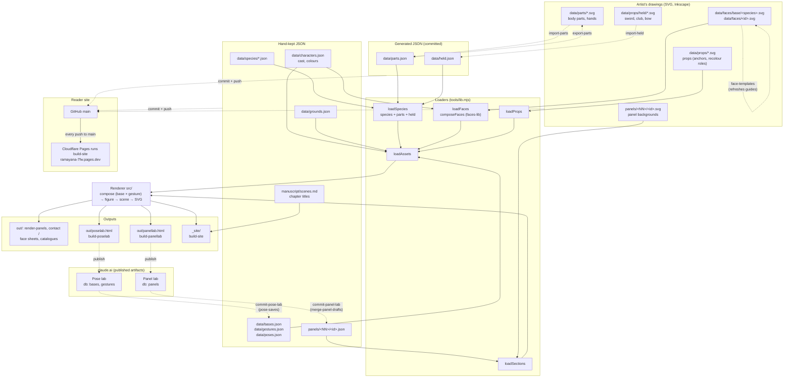

# Pipeline: from drawings to the published site

How the artist's drawings and the hand-kept JSON reach the renderer, the
labs and the reader site. Solid arrows are automatic (read on load);
dashed arrows are a step someone runs.

## Notes

- **Read on every load, with no step in between:** props
  (`data/props/*.svg`), faces (composed from the base and character
  drawings by `composeFaces`), and every hand-kept JSON. Editing one of
  these files changes the next render.
- **Imported into committed JSON:** body parts (`import-parts`, which
  `export-parts` writes back as the editable SVG) and held props
  (`import-held`). Rerun the import after editing those drawings.
- **Check tools:** `check-faces` (the face drawings), `prop-gaps`,
  `pose-gaps`, `view-gaps` (the queues in `docs/issues/`). `npm test`
  covers the data and a render snapshot.
- **The labs** are self-contained pages, with the renderer and every
  asset inlined at build time. Rebuild and republish them after renderer,
  data or panel changes. The artist's saves go to each lab's database and
  reach the repo only through the commit skills, which also delete the
  merged saves.
- **The site** is built by Cloudflare from `main`, not from a local
  `_site/`, on every push to `main` (`docs/design/panels.md`,
  Publishing): a push is a publish.
